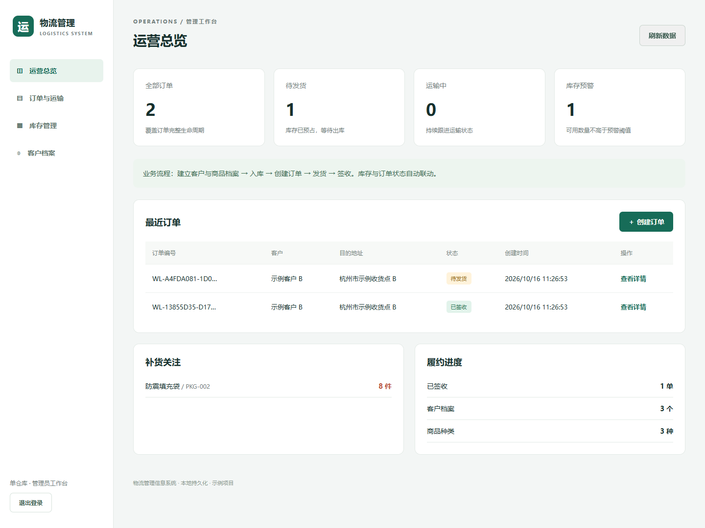
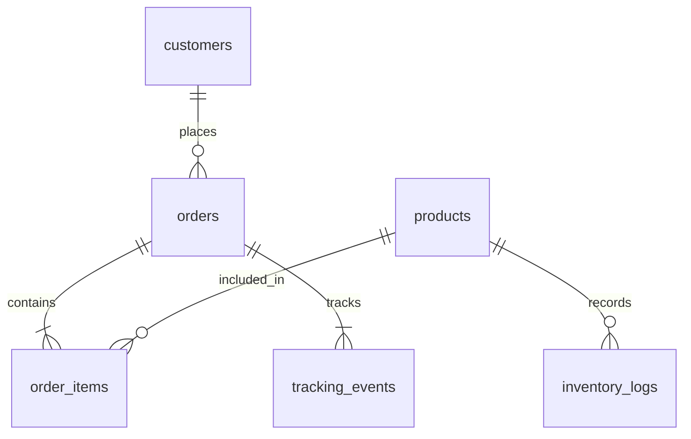

# 物流管理信息系统

一个可在本地直接运行的中文物流管理示例，覆盖 **客户建档 → 商品入库 → 创建订单 → 安排发货 → 物流跟踪 → 签收**。代码包含中文注释、SQLite 持久化、管理员登录、自动化测试及 GitHub Actions 检查，适合课程设计、毕业设计原型和学习全栈开发。



## 技术方案

| 层级 | 技术 | 说明 |
| --- | --- | --- |
| 服务端 | Node.js 24+、原生 HTTP | 无第三方运行依赖 |
| 数据库 | SQLite、`node:sqlite` | 首次启动自动建表，数据保存到本地文件 |
| 前端 | HTML、CSS、原生 JavaScript | 中文响应式页面，不需要打包 |
| 测试 | `node:test` | 覆盖库存事务、状态迁移、持久化及 HTTP 认证 |

> 需要 Node.js **24 或更高版本**。推荐使用 Node.js 24 LTS。无需运行 `npm install`，无需单独安装 SQLite 或 MySQL。部分 Node.js 版本会显示 SQLite 实验特性提示，不影响本项目演示运行。

## 快速启动

```bash
git clone https://github.com/Zhaoyi0920/1128.git
cd 1128
node src/server.js
```

如果通过 ZIP 下载，请解压后进入包含 `package.json` 的目录，再运行最后一条命令。

1. 打开终端提示的地址，默认是 **http://127.0.0.1:3000**。
2. 将终端输出的“本次启动的管理员密码”输入登录页。
3. 首次启动会创建虚构客户和三种商品，并录入示例库存。
4. 点击“创建订单”开始体验。只有手动执行发货、物流录入、签收，订单才会进入后续状态。

未配置密码时，每次启动都会生成新密码；业务数据保留，旧登录会话失效。请勿把终端中的密码提交到 GitHub。

也可以设置自己的密码（至少 12 个字符）：

**Windows PowerShell**

```powershell
$env:ADMIN_PASSWORD = '请替换为你自己的长密码123'
node src/server.js
```

**macOS / Linux**

```bash
ADMIN_PASSWORD='请替换为你自己的长密码123' node src/server.js
```

安装 Node.js 时附带 npm 的环境也可使用 `npm start`、`npm test` 和 `npm run check`。

## 功能与操作

| 模块 | 已实现功能 |
| --- | --- |
| 运营总览 | 全部订单、待发货、运输中、库存预警统计；最近订单；补货提醒 |
| 客户档案 | 新建客户，记录名称、电话、地址，搜索客户 |
| 库存管理 | 新建唯一 SKU；入库和盘亏；实物/预占/可用库存；阈值预警；最近 100 条库存流水 |
| 订单管理 | 多商品订单、重复商品合并、库存不足校验、搜索、按状态筛选、CSV 导出 |
| 运输管理 | 承运商与运单号录入、手动追加物流节点、签收、查看完整订单轨迹 |
| 访问管理 | 管理员密码登录、八小时会话、退出登录、密码错误限流、同源校验与 CSRF 令牌 |

### 建议演示步骤

1. 进入“客户档案”添加一个客户，或使用已有的虚构客户。
2. 进入“库存管理”，检查“标准包装箱”可用库存；也可新建商品后点击“入库 / 调整”。
3. 创建包含 3 件标准包装箱的订单。此时实物库存不变，预占增加 3，可用减少 3。
4. 查看订单详情，点击“安排发货”，填写承运商和运单号。实物库存减少 3，预占释放。
5. 添加“已到达分拨中心”等物流节点，然后确认签收。
6. 再创建一个待发货订单并取消，观察预占库存恢复。
7. 重启服务器，重新登录，确认订单和库存仍然存在。

## 库存与状态规则

```text
待发货 pending ──安排发货──> 运输中 shipped ──确认签收──> 已签收 delivered
       │
       └──取消订单──> 已取消 cancelled
```

- `可用库存 = 实物库存 stock - 预占库存 reserved`。
- 创建订单只预占库存，不立即扣减实物库存。
- 发货同时扣减实物库存和预占库存，并写入出库流水。
- 取消仅适用于待发货订单，只释放预占，不增加实物库存。
- 签收不再扣减库存；已签收、已取消订单不能再次变更状态。
- 入库使用正整数，盘亏使用负整数，不能输入 0；调整后实物库存不能低于预占。
- 可用库存小于或等于预警阈值时提示补货。
- 涉及多条数据的业务由 SQLite 事务统一提交；任一商品不足会回滚整张订单。
- 订单及库存流水保留历史，当前版本未提供删除或修改历史记录的入口。

## 项目结构

```text
.
├── src/
│   ├── db.js              # 数据表、数据库连接及演示数据
│   ├── service.js         # 输入校验、库存事务、订单状态、统计
│   └── server.js          # HTTP 路由、登录会话、静态资源及启动入口
├── public/
│   ├── index.html         # 登录页和工作台结构
│   ├── style.css          # 中文响应式布局
│   └── app.js             # 页面渲染、表单、接口调用及 CSV 导出
├── test/
│   ├── service.test.js    # 业务规则与数据库持久化测试
│   └── http.test.js       # 登录、CSRF、接口流程与请求边界测试
├── docs/API.md            # 接口说明与请求示例
├── .github/workflows/ci.yml
├── .gitignore
├── package.json
└── README.md
```

### 数据关系



数据库默认生成在 `data/logistics.sqlite`。开启 WAL 模式时，同目录可能出现 `-wal` 和 `-shm` 文件；这些文件及密码配置均已在 `.gitignore` 中排除。

## 配置

| 环境变量 | 默认值 | 用途 |
| --- | --- | --- |
| `ADMIN_PASSWORD` | 启动时随机生成 | 管理员密码，至少 12 字符 |
| `HOST` | `127.0.0.1` | 监听地址，仅本机访问 |
| `PORT` | `3000` | HTTP 端口 |
| `DB_PATH` | `data/logistics.sqlite` | SQLite 路径，相对于启动目录 |
| `SEED_DEMO` | `true` | 设置为 `false` 可禁用演示数据，仅空数据库会初始化 |
| `SECURE_COOKIES` | `false` | HTTPS 反向代理部署时设为 `true` |

程序不会自动读取 `.env`。可在操作系统中设置环境变量，或使用 Node.js 自带的 `node --env-file=.env src/server.js`。请自行创建 `.env` 并保持其不入库。

所有时间以 UTC 存储，页面按浏览器所在时区显示。订单数量、库存数量的单位为“件”；当前没有金额和计费模块。

## 验证与持续集成

```bash
node --test
node --check src/server.js
node --check src/service.js
node --check src/db.js
node --check public/app.js
```

测试使用内存数据库与临时数据库，不修改实际业务库。推送至 GitHub 或创建 Pull Request 时，工作流会在 Node.js 24 上执行语法检查和测试。

## 数据备份

先停止服务，再备份整个 `data/` 目录。恢复时，在停止服务的情况下恢复该目录，然后重新启动。不要只复制正在写入的主数据库文件，以免漏掉 WAL 中尚未合并的数据。

## 当前边界与扩展方向

这是单管理员、单仓库的教学原型。物流节点需要手动录入，未接入真实快递 API、地图、短信或支付，也未实现多角色、多仓库、退货、车辆调度、自动计费及多实例共享会话。

默认只监听本机 HTTP。若要作为实际业务系统对外部署，应配置 HTTPS 反向代理、固定强密码及 `SECURE_COOKIES=true`，保留原始 `Host` 请求头，并进一步设计账号权限、完整操作审计、数据库迁移及备份机制。商品名称和客户资料目前是引用当前档案；后续如新增档案编辑功能，应同时设计订单快照。

本仓库未附开源许可证。需要公开授权他人使用或分发时，请由仓库所有者选择合适的 LICENSE。
